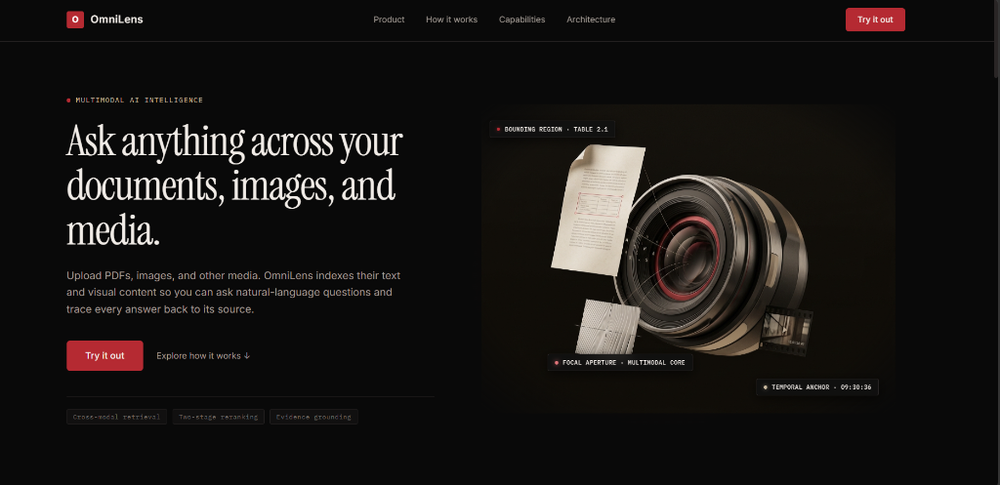
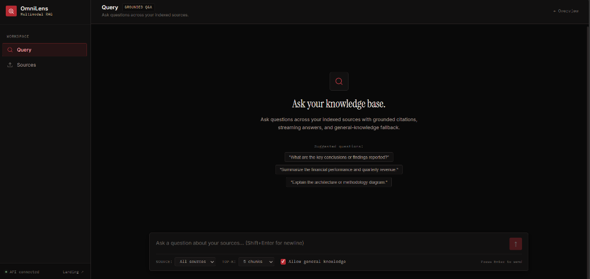
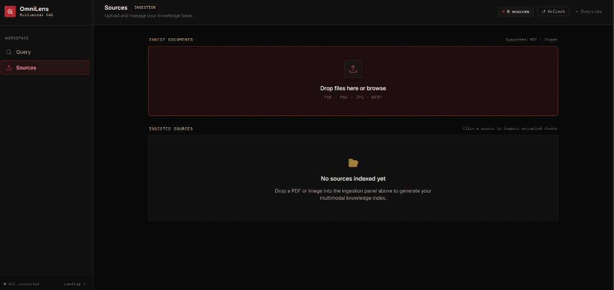
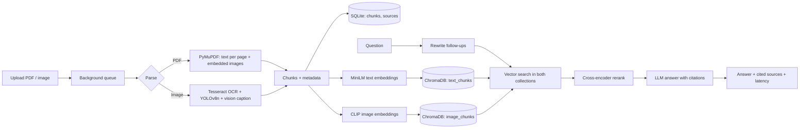

# OmniLens

**Multimodal RAG: ask questions across your PDFs and images, and get answers that cite the exact page or image they came from.**


## Screenshots

### Landing Page


### Grounded Q&A Interface
Ask questions across indexed multimodal sources with real-time streaming, grounded citations, and general-knowledge fallback.


### Multimodal Sources & Ingestion
Upload and manage PDFs and images with live ingestion status and chunk inspection.


---

## Why this project

Most RAG demos only handle plain text. Real study material and work documents are mixed: scanned pages, diagrams, screenshots, and PDFs with embedded figures. OmniLens indexes both text and visuals into one searchable knowledge base, and every answer links back to its source, so you can verify it instead of trusting the model.

If the selected documents do not contain the answer, OmniLens says so. It can optionally fall back to the model's general knowledge, but that answer is clearly labeled and never carries document citations.

## Features

- **PDF and image ingestion.** PDFs are parsed page by page (text and embedded images). Images go through OCR, object detection, and a vision-language model that writes a searchable description.
- **Two-space retrieval.** Text chunks are embedded with sentence-transformers and images with CLIP. Each question is embedded in both spaces, and results are merged.
- **Two-stage ranking.** Fast vector search retrieves candidates, then a cross-encoder reranks them before generation.
- **Grounded answers with citations.** Every claim must cite a page or image. Citations are clickable and show the original extracted content.
- **Whole-document mode.** Aggregate questions ("how many problem statements are in this file?") send all pages of the selected source instead of only the top chunks.
- **Labeled general-knowledge fallback.** When the documents lack the answer, an optional second call answers from model knowledge, marked "General knowledge" with no citations. It can be switched off for strict mode.
- **Follow-up questions.** Short follow-ups ("what about the next one?") are rewritten into standalone questions using recent chat history.
- **Streaming answers** over Server-Sent Events, with live stage indicators (searching, ranking, writing).
- **Background ingestion queue.** Uploads return immediately; a single worker processes files in order with visible progress and a "ready" state.
- **Source management.** Inspect extracted chunks, re-index, or delete a source (vectors, chunks, files, and stale cached answers are all removed).
- **Three-layer cache** for final answers, retrieval results, and embeddings (content-hash deduplication).
- **Friendly errors.** Provider failures are mapped to short, retryable messages. Raw API errors never reach the UI.
- **Evaluation harness** that measures retrieval accuracy and latency against a hand-written question set.

## Architecture



### How a query works

1. **Rewrite.** If there is chat history, the question is turned into a standalone question.
2. **Mode selection.** Aggregate questions on a selected source use whole-document mode; everything else uses focused retrieval.
3. **Retrieve.** The question is embedded twice (MiniLM and CLIP text encoder) and both ChromaDB collections are searched. Filename mentions narrow the search to that source.
4. **Rerank.** A cross-encoder rescores candidates. Image chunks are scored through their caption and OCR text, because the cross-encoder works on text pairs.
5. **Generate.** The LLM answers only from the supplied chunks and cites them. If the answer is absent, it returns a sentinel instead of guessing.
6. **Fallback (optional).** On the sentinel, a labeled general-knowledge answer is produced if the toggle is on.
7. **Cache.** Final answers and retrieval results are cached; a repeated question returns almost instantly.

### Design decisions

| Decision | Reason |
|---|---|
| ChromaDB in embedded mode | No server or Docker needed; the vector store is a folder on disk. |
| Two embedding spaces instead of one joint space | Simpler and more reliable on CPU. Text uses MiniLM, images use CLIP, and queries are embedded for both. |
| Retrieve, then rerank | Cheap vector search narrows the pool; the slower cross-encoder only scores a handful of candidates. |
| Vision caption at ingestion | Makes diagrams and screenshots findable by text queries, and lets a text-only generator answer about them. |
| Sentinel token for "not in documents" | The refusal is detected in code, not by matching phrasing, so the fallback logic is reliable. |
| Single background worker | Heavy models never run in parallel on a laptop; ingestion stays predictable. |
| Cache keys include answer source and mode | A general-knowledge answer is never served in place of a document-grounded one. |

## Tech stack

| Layer | Tools |
|---|---|
| Backend | FastAPI, Uvicorn, Python 3.11 |
| Storage | SQLite (metadata), ChromaDB (vectors), diskcache (caching) |
| Parsing / vision | PyMuPDF, Tesseract OCR, YOLOv8n (Ultralytics) |
| Embeddings | `all-MiniLM-L6-v2` (384-dim), CLIP ViT-B-32 via open_clip (512-dim) |
| Reranking | `cross-encoder/ms-marco-MiniLM-L-6-v2` |
| LLM / VLM | Groq API (text model for answers, vision model for image captions; configurable) |
| Frontend | React (Vite), plain CSS |

Everything except the Groq calls runs locally on CPU, with no Docker.

## Getting started

### Prerequisites

- Python 3.11
- Node.js 18+
- [Tesseract OCR](https://github.com/UB-Mannheim/tesseract/wiki) installed and on your `PATH` (Windows installer linked; on macOS `brew install tesseract`, on Ubuntu `sudo apt install tesseract-ocr`)
- A free [Groq API key](https://console.groq.com/keys)
- About 1 GB of free disk space for model weights, which download automatically on first run

### Backend

```powershell
git clone https://github.com/Tanya0301-oss/omnilens.git
cd omnilens

python -m venv venv
.\venv\Scripts\Activate.ps1          # macOS/Linux: source venv/bin/activate
pip install -r requirements.txt

copy .env.example .env               # macOS/Linux: cp .env.example .env
# edit .env and add your GROQ_API_KEY and model names (see below)

uvicorn app.main:app --reload
```

The API runs at `http://127.0.0.1:8000` (interactive docs at `/docs`). The first start takes longer while models download.

### Frontend

```powershell
cd frontend
npm install
npm run dev
```

Open the URL Vite prints (usually `http://localhost:5173`).

### Configuration

Set these in `.env` (see `.env.example` for the full list):

| Variable | Purpose |
|---|---|
| `GROQ_API_KEY` | Your Groq API key. Never commit this file. |
| `GROQ_MODEL` | Text model used for answers. |
| `GROQ_VISION_MODEL` | Vision-capable model used to caption images. |
| `GROQ_REWRITE_MODEL` | Optional smaller model for rewriting follow-up questions. |

Available model names change over time and differ per account. List the ones your key can use with:

```powershell
python test_llm.py --list-models
```

## Usage

1. Open the app and go to **Sources**. Upload one or more PDFs or images and wait for each to show **Ready**.
2. Go to **Query**, optionally pick a specific source, and ask a question.
3. Click a citation chip to see the page text or the image behind the answer.
4. Use **Details** under an answer to see the mode used, model, cache status, and per-stage latency.

Example questions: "What is the aim of Experiment 1?", "How many problem statements are in this document?", "What tables are in the schema diagram?"

## API overview

| Method | Endpoint | Description |
|---|---|---|
| `POST` | `/upload` | Upload a PDF or image; returns immediately and processes in the background |
| `GET` | `/sources` | List sources with status and chunk counts |
| `GET` | `/sources/{id}/status` | Processing stage and progress |
| `GET` | `/source/{id}` | All extracted chunks for a source |
| `POST` | `/query` | Full pipeline, returns a complete answer |
| `POST` | `/query/stream` | Same pipeline, streamed over SSE |
| `POST` | `/source/{id}/reindex` | Re-process a source |
| `DELETE` | `/source/{id}` | Remove a source and all its indexed data |
| `GET` | `/health` | Health check |

## Project structure

```
omnilens/
├── app/
│   ├── main.py            # FastAPI entrypoint
│   ├── api/               # upload, query, status/source routes
│   ├── ingestion/         # PDF/image parsers, background worker
│   ├── embeddings/        # text (MiniLM) and image (CLIP) embedders
│   ├── retrieval/         # ChromaDB wrapper, reranker, backfill/reindex
│   ├── generation/        # LLM calls, prompts, citation parsing
│   ├── cache/             # diskcache layers
│   ├── db/                # SQLite metadata store
│   └── utils/             # logging, error mapping
├── frontend/              # React + Vite app
├── eval/                  # evaluation questions and runner
├── data/                  # runtime data (gitignored)
└── requirements.txt
```

## Evaluation

The `eval/` folder contains a hand-written question set and a runner that calls the API in strict mode (general-knowledge fallback disabled), so the numbers measure retrieval and grounding, not the model's memory.

```powershell
python eval/run_eval.py
```

> **Fill these in with your own measured results before publishing.**

| Metric | Result |
|---|---|
| Questions in test set | _N_ |
| Retrieval accuracy (correct source cited) | _X %_ |
| Correct refusals on out-of-document questions | _X / N_ |
| Median latency, uncached | _X s_ |
| Median latency, cached | _X s_ |

Test set composition: _describe your documents, e.g. 2 PDFs and 3 images, number of text vs image questions_.

## Limitations

Being upfront about what this is and is not:

- **Local, single-user prototype.** There is no authentication; everyone using the app shares one workspace.
- **One worker, one machine.** Ingestion is serialized on purpose. This is not a horizontally scaled system.
- **Whole-document mode is size-limited.** It works for short documents; very long files exceed the model's context window and are truncated by page order. Summarize-then-combine is not implemented.
- **Image answers depend on the caption.** A vision model can misread small text or invent relationships in dense diagrams, and the index inherits those errors.
- **Cross-encoder reranking uses text proxies for images** (caption and OCR text), not the pixels.
- **External API dependency.** Answers and image captions use Groq, so uploaded content is sent to that service, and free-tier rate limits apply. Do not upload sensitive documents.
- **No video or audio support.**
- **Embedded ChromaDB** suits thousands of chunks, not millions.

## Future work

- Video and audio ingestion (frame sampling plus speech-to-text, with timestamp citations)
- Summarize-then-combine for long documents
- User accounts and per-user workspaces
- Queue and cache backed by Redis, and a server-mode vector database (such as Qdrant) for multi-user deployment
- Page-image previews with highlighted evidence regions
- Metrics dashboard (Prometheus and Grafana) for per-stage latency

## License

Add a license of your choice (MIT is a common default for portfolio projects).

## Author

**Tanya Maheshwari**: [GitHub](https://github.com/Tanya0301-oss)
